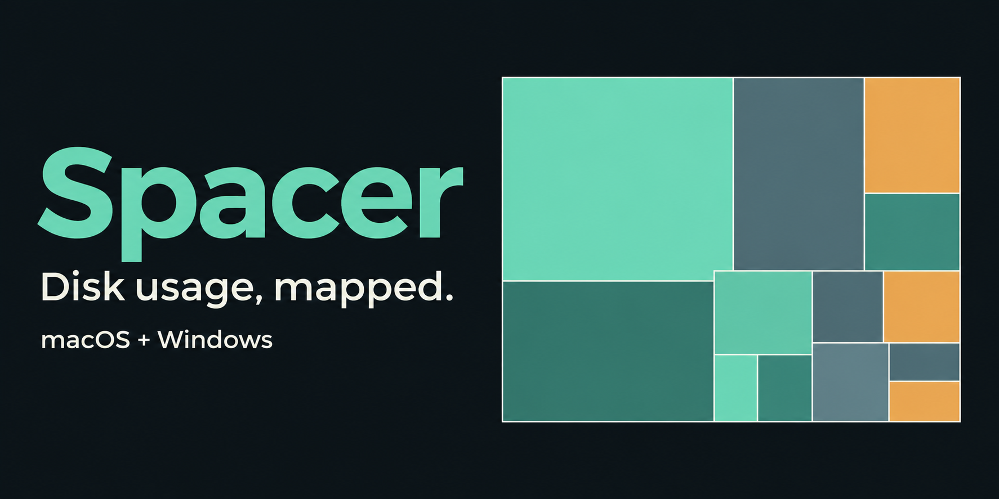
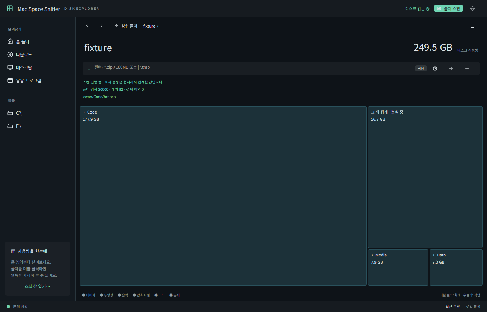

# Spacer



A desktop disk usage analyzer for macOS and Windows. See which folders take up space, drill into the large ones, and decide what to keep.


*macOS development build, using test data. The app still displays its earlier name, Mac Space Sniffer. The current UI is in Korean.*

## What it does

- **Browse a treemap.** Rectangle sizes show disk usage. Double-click a folder to open it, then use back, forward, or up to move around.
- **See results while scanning.** The map fills in as the scan progresses; you don't have to wait for the entire tree.
- **Filter and tag files.** Narrow the view by name, size, or modification date, and mark items with color tags.
- **Save a snapshot.** Save and reopen SNS snapshots, read DU files, or export a file list.
- **Work with files.** Preview an item, reveal it in Finder or Explorer, copy its path, or move it to the trash.
- **Keep the view up to date.** Watch the scanned folder for changes or request another scan.

Both platforms use the same Rust/GPUI interface. Filesystem access, previews, and other OS-specific behavior sit behind platform adapters.

## Using Spacer

1. Choose **Folder Scan** to select a folder. In the current Korean UI, this is **폴더 스캔**.
2. Start with the largest rectangles. Select an item to see its path and size in the details panel.
3. Double-click a folder to look inside, or apply a filter to narrow the results.

Filter conditions are separated by semicolons (`;`). A few examples:

| Filter | Matches |
|---|---|
| `*.zip;*.dmg` | ZIP or DMG files |
| `*.zip;>100mb` | ZIP files using at least 100 MiB on disk |
| `>30d` | Items last modified at least 30 days ago |
| `\node_modules` | Files with a node_modules folder in their path |
| `\|*.tmp` | Excludes TMP files |

An SNS snapshot is an offline record of a scan. Its paths may belong to another computer or no longer exist on the current one.

### During a scan



*Windows development build. Paths and sizes in this capture are test data.*

## Platforms and downloads

| Platform | Verified environment |
|---|---|
| macOS | Apple Silicon, macOS 14 or later |
| Windows | Windows 10 x64, tested on physical hardware |

Intel Mac runtime support has not been verified. Previews use Quick Look on macOS and a separate helper on Windows, so supported file types differ.

Mac DMG and Windows EXE packages have been built for 0.3.0, but **public downloads are not available yet**. The new Windows installer still needs install/uninstall testing. The Mac package is ad-hoc signed and not notarized; the Windows package is unsigned.

You can build from source using the steps below.

## Building from source

### macOS

Install Xcode or Command Line Tools, Swift, and Rust 1.97.

```sh
git clone https://github.com/aidoinnov/Spacer.git
cd Spacer
./scripts/build-gpui-app.sh
```

The app is written to `dist/gpui-builds/`. `dist/Mac Space Sniffer GPUI.app` points to the latest build. Building does not replace an installed copy.

### Windows

Use an **x64 Developer PowerShell** with Visual Studio build tools, the Windows SDK, Swift 6.2.4 and its matching runtime, and Rust 1.97. Shared Swift sources use symbolic links; make sure your checkout preserves them.

```powershell
.\scripts\build-gpui-app.ps1 `
  -SwiftBin "C:\path\to\swift\usr\bin" `
  -SwiftRuntimeDirectory "C:\path\to\swift-runtime\usr\bin"
```

Replace both paths with your toolchain and runtime locations. The output includes the GUI, scan backend, preview helper, and runtime DLLs. See the [GPUI build notes](gpui-app/README.md) for details; those notes are currently in Korean.

### Checks

```sh
python3 scripts/gpui-app/check-shared-domain.py
python3 scripts/gpui-app/check-fonts.py
python3 scripts/check-gpui-boundary.py
cargo +1.97.0 test --locked --manifest-path gpui-app/Cargo.toml
```

The source tree includes scan-engine changes that are not part of the validated 0.3.0 packages. A source build will therefore differ from those packages. Performance acceptance for those changes is still pending.

CLI and MCP test coverage, fixes, and remaining gaps are recorded in the
[CLI/MCP validation report](docs/CLI_MCP_VALIDATION.md). The GPUI executable provides
`--help` and `--version`; the legacy headless `--cli` is not included in its package.

## Source layout

| Path | Contents |
|---|---|
| `gpui-app/` | Shared Rust/GPUI interface, navigation, and input handling |
| `Sources/SpaceSnifferCore/` | Shared Swift document, filter, tree, and aggregation code |
| `Packages/SpaceSnifferScanEngine/` | Directory work, cancellation, and parallel scheduling |
| `Packages/SpaceSnifferExplorerBridge/` | Shared document services and the Windows backend |
| `Packages/SpaceSnifferWindows/` | Windows filesystem access and scanning |
| `scripts/gpui-app/` | Packaging and application validation tools |

Development notes and validation reports live in [docs](docs/), mostly in Korean. They also record platform limitations and measurements that are not yet complete.

Spacer grew out of SpaceSniffer's treemap navigation model. It is not an official Uderzo Software product. The interface uses [GPUI](https://github.com/zed-industries/zed/tree/main/crates/gpui) and GPUI Kit, with [Noto Sans KR](gpui-app/assets/fonts/OFL.txt) and Lucide icons.
