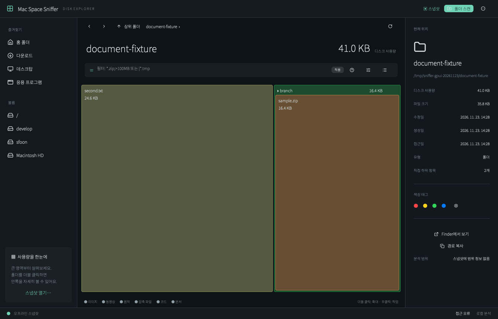

# Spacer

macOS와 Windows에서 폴더별 디스크 사용량을 트리맵으로 살펴보는 데스크톱 앱입니다.
큰 파일을 찾고, 폴더 안으로 들어가 보고, 정리할 항목을 고를 때 사용합니다.



*0.3.0 개발 빌드의 macOS 화면입니다. 테스트 데이터를 사용했으며, 앱 안에는 이전 이름인 Mac Space Sniffer가 남아 있습니다.*

## 주요 기능

- **트리맵 탐색** — 파일과 폴더의 사용량을 사각형 크기로 표시합니다. 폴더를 더블클릭해 들어가고, 뒤로·앞으로·상위 폴더로 이동할 수 있습니다.
- **분석 중 결과 표시** — 전체 분석이 끝나기 전에도 지금까지 집계한 결과를 보여줍니다.
- **필터와 태그** — 파일명, 크기, 수정 시점 등으로 결과를 좁히고 색상 태그를 붙일 수 있습니다.
- **스냅샷과 보고서** — SNS 스냅샷을 저장하거나 다시 열고, 파일 목록을 내보낼 수 있습니다. DU 파일도 읽습니다.
- **파일 작업** — 미리보기, Finder·탐색기에서 보기, 경로 복사, 휴지통 이동을 지원합니다.
- **변경 감지** — 분석한 폴더의 변경을 감지해 결과를 갱신하고, 필요할 때 다시 검사합니다.

Mac과 Windows 모두 Rust/GPUI로 만든 공통 UI를 사용합니다. 파일시스템 접근과 미리보기 등 OS에 따라 달라지는 부분은 별도로 처리합니다.

## 사용 방법

1. **폴더 스캔**에서 확인할 폴더를 선택합니다.
2. 트리맵의 큰 영역부터 살펴봅니다. 항목을 선택하면 오른쪽에서 경로와 크기를 확인할 수 있습니다.
3. 폴더를 더블클릭해 안으로 들어가거나, 필터를 적용해 원하는 파일만 남깁니다.

필터는 다음처럼 입력합니다. 조건은 세미콜론(`;`)으로 구분합니다.

| 입력 | 의미 |
|---|---|
| `*.zip;*.dmg` | ZIP 또는 DMG 파일 |
| `*.zip;>100mb` | 디스크 사용량이 100 MiB 이상인 ZIP 파일 |
| `>30d` | 수정한 지 30일 이상 지난 항목 |
| `\node_modules` | 경로에 node_modules 폴더가 포함된 파일 |
| `\|*.tmp` | TMP 파일 제외 |

SNS 스냅샷은 저장한 시점의 결과를 오프라인으로 확인하는 용도입니다. 스냅샷에 기록된 경로가 현재 컴퓨터에 그대로 존재한다는 뜻은 아닙니다.

### 분석 중 화면


*Windows 개발 빌드에서 분석 진행 화면을 검증한 캡처입니다. 표시된 경로와 용량은 테스트 데이터입니다.*

## 지원 환경과 설치

| 플랫폼 | 확인한 환경 |
|---|---|
| macOS | Apple Silicon, macOS 14 이상 |
| Windows | Windows 10 x64 실기기 |

Intel Mac에서의 실행은 아직 확인하지 않았습니다. 미리보기는 macOS에서 Quick Look을, Windows에서 별도 preview helper를 사용하며 지원 형식에는 차이가 있습니다.

0.3.0용 Mac DMG와 Windows 설치 EXE를 만들었지만, **공개 다운로드는 아직 제공하지 않습니다.** Windows 설치·제거 프로그램의 실제 실행 검수와 배포 서명 작업이 남아 있습니다. 현재 Mac 패키지는 ad-hoc 서명, Windows 패키지는 unsigned입니다.

소스에서 실행하려면 아래 빌드 절차를 사용하세요.

## 소스 빌드

### macOS

Xcode 또는 Command Line Tools, Swift, Rust 1.97이 필요합니다.

```sh
git clone https://github.com/aidoinnov/Spacer.git
cd Spacer
./scripts/build-gpui-app.sh
```

빌드한 앱은 `dist/gpui-builds/`에 생성됩니다. `dist/Mac Space Sniffer GPUI.app`은 가장 최근 빌드의 바로가기입니다. 실행 중인 설치본을 자동으로 교체하지 않습니다.

### Windows

Visual Studio의 **x64 Developer PowerShell**, Windows SDK, Swift 6.2.4와 일치하는 Swift runtime, Rust 1.97이 필요합니다. 저장소는 공유 Swift 소스를 심볼릭 링크로 연결하므로, 체크아웃할 때 링크가 실제 파일로 처리되는지도 확인해야 합니다.

```powershell
.\scripts\build-gpui-app.ps1 `
  -SwiftBin "C:\path\to\swift\usr\bin" `
  -SwiftRuntimeDirectory "C:\path\to\swift-runtime\usr\bin"
```

두 경로는 설치한 Swift toolchain과 runtime 위치로 바꿉니다. 결과에는 GUI, 스캔 backend, preview helper와 필요한 runtime DLL이 함께 들어갑니다. 자세한 구성은 [GPUI 빌드 문서](gpui-app/README.md)를 참고하세요.

### 검사

```sh
python3 scripts/gpui-app/check-shared-domain.py
python3 scripts/gpui-app/check-fonts.py
python3 scripts/check-gpui-boundary.py
cargo +1.97.0 test --locked --manifest-path gpui-app/Cargo.toml
```

현재 소스에는 검증된 0.3.0 패키지에 넣지 않은 스캔 엔진 개선 후보도 포함되어 있습니다. 소스 빌드와 기존 배포 후보의 바이너리는 같지 않습니다. 성능 개선 여부는 별도 측정이 끝난 뒤 판단합니다.

## 코드 구성

| 위치 | 역할 |
|---|---|
| `gpui-app/` | 공통 Rust/GPUI 화면, 탐색과 사용자 입력 |
| `Sources/SpaceSnifferCore/` | 문서, 필터, 트리와 집계 등 Swift 공통 코드 |
| `Packages/SpaceSnifferScanEngine/` | 디렉터리 작업, 취소, 병렬 처리 정책 |
| `Packages/SpaceSnifferExplorerBridge/` | 공통 문서 기능과 Windows backend 연결 |
| `Packages/SpaceSnifferWindows/` | Windows 파일시스템 접근과 스캔 |
| `scripts/gpui-app/` | 패키징과 앱 검수 도구 |

개발 경위와 검증 기록은 [docs](docs/)에 있습니다. 성능 측정이 끝나지 않은 항목과 플랫폼별 제약도 기록해 두었습니다.

Spacer는 SpaceSniffer의 트리맵 탐색 방식에서 출발한 프로젝트이며, Uderzo Software의 공식 제품은 아닙니다. UI는 [GPUI](https://github.com/zed-industries/zed/tree/main/crates/gpui)와 GPUI Kit를 사용합니다. 글꼴은 [Noto Sans KR](gpui-app/assets/fonts/OFL.txt), 아이콘은 Lucide를 사용합니다.
