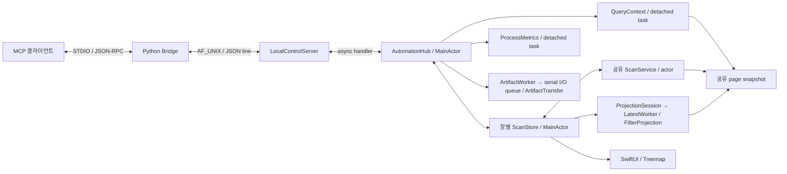
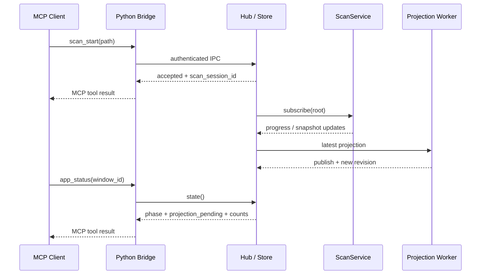
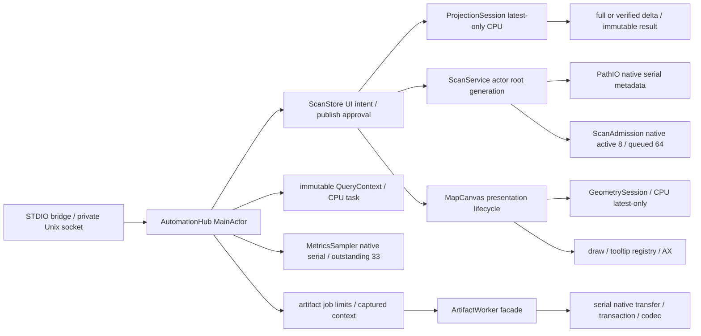

# Mac Space Sniffer MCP 기술 설계서

작성 기준: 2026-11-08 작업 트리. 앱 `0.1.0`, MCP bridge `1.0.0`, 내부 IPC descriptor `version=1`. 이 문서는 현재 구현을 설명한다. 향후 개선 제안은 마지막 절에 분리했다.

실행 중인 macOS 앱의 실제 상태와 기존 엔진을 MCP로 제어한다. Python bridge가 MCP 전송을 담당하고 앱 내 `AutomationHub`가 창과 `ScanStore`를 선택한다. 파일 순회·합산·필터·태그·SNS 처리는 기존 `SpaceSnifferCore`를 호출한다. 조회를 위해 별도 전체 트리 사본이나 별도 스캐너를 유지하지 않는다.

빠른 연결은 [사용 가이드](MCP.md), 도구별 입력·출력은 [API 명세](MCP_API_REFERENCE.md), 검증 근거는 [검증 결과](VALIDATION.md)를 참고한다.

## 1. 범위와 원본 근거의 경계

| 구분 | 이번 구현의 역할 | 근거와 담당 코드 |
|---|---|---|
| 원본에서 확인한 엔진 동작 | 합산·필터·태그·탐색·SNS·보고서 계약 재사용 | [원본 분석](ENGINE_REVERSE_ENGINEERING.md), [계약표](engine-contracts.json), `SpaceSnifferCore` |
| macOS 플랫폼 연동 | actor/worker, Unix socket, 권한·프로세스 측정·AppKit 캡처 | `SpaceSnifferAutomation`, `AutomationHub` |
| MCP 전송 | JSON-RPC, 도구 카탈로그, 버전 처리, 결과 포장 | `scripts/mcp/space_sniffer_mcp.py` |
| 기존 UI | 동일한 창·focus·필터·태그를 변경하고 표시 | `ScanStore`, `ContentView`, `TreemapView` |

MCP의 도구 이름·페이지 크기·소켓 제한·작업 보관 수는 이 앱의 연동 설계다. Windows 원본에 MCP가 있거나 동일한 RPC 구조를 사용한다는 의미가 아니다. 원본 동작의 정적 분석과 Windows 실행 비교의 미완료 범위는 기존 분석 문서에 유지한다.

`ArtifactWorker.save/export`에는 `replaceExisting: Bool = true`가 추가되어 있다. 기존 UI는 기본값을 사용하고 MCP는 `false`를 전달한다. 파일 형식과 정렬 규칙을 바꾸는 옵션이 아니라 출력 파일 충돌을 처리하는 플랫폼 I/O 정책이다.

## 2. 구성 요소와 의존성



| 파일 | 책임 | 수정 시 함께 확인할 부분 |
|---|---|---|
| [Package.swift](../Package.swift) | core·automation·앱 target 의존성 | automation이 AppKit UI에 의존하지 않도록 유지 |
| [App.swift](../Sources/MacSpaceSniffer/App.swift) | 앱 시작 시 controller 생성, 종료 시 `stop()` | 시작 실패 시 앱은 계속 실행하며 NSLog만 남김 |
| [ContentView.swift](../Sources/MacSpaceSniffer/ContentView.swift) | 창 attachment 부착, 화면 소멸 시 등록 해제 | `ScanStore.shutdown()` 수명 |
| [AutomationHub.swift](../Sources/MacSpaceSniffer/AutomationHub.swift) | 창 선택·상태·도구 dispatch·artifact job·캡처 | MainActor 재진입과 비동기 작업 후 revision 검증 |
| [ScanStore.swift](../Sources/MacSpaceSniffer/ScanStore.swift) | 기존 UI 상태와 projection, 엔진 구독 | generation/revision/projection 의미 구분 |
| [LocalControlServer.swift](../Sources/SpaceSnifferAutomation/LocalControlServer.swift) | 로컬 listener·인증·프레임 읽기/쓰기 | UID·mode·크기·연결 수·SIGPIPE |
| [JSONValue.swift](../Sources/SpaceSnifferAutomation/JSONValue.swift) | Sendable JSON 값과 IPC envelope | 정수·실수·bool을 서로 구분 |
| [Queries.swift](../Sources/SpaceSnifferAutomation/Queries.swift) | 경로 해석·노드 직렬화·페이지·상위 K | 전체 트리 비용과 cursor 의미 |
| [ProcessMetrics.swift](../Sources/SpaceSnifferAutomation/ProcessMetrics.swift) | 앱 자신의 Mach/getrusage 수치 | 커널 실패 시 null/상태 코드 |
| [space_sniffer_mcp.py](../scripts/mcp/space_sniffer_mcp.py) | STDIO server·도구 schema·앱 발견·IPC client | stdout 전용성, schema와 앱 명령 정합성 |
| [build-app.sh](../scripts/build-app.sh) | bridge를 앱 Resources/MCP에 포함 | 복사 후 서명·ZIP 생성 순서 |

`SpaceSnifferAutomation`은 core에 의존한다. 앱 target은 core와 automation에 의존한다. Python bridge는 Swift 패키지 외부의 stdlib 전용 실행 파일이다. 앱 번들에 Python 인터프리터를 포함하지 않는다.

## 3. 프로세스·창·엔진 수명

### 3.1 시작과 종료

1. `applicationDidFinishLaunching`에서 `LocalControlServer`를 만든다.
2. 사용자 전용 디렉터리와 소켓을 만들고 descriptor를 기록한다.
3. `AutomationWindowAttachment.viewDidMoveToWindow()`가 창과 store를 Hub에 등록한다.
4. bridge는 각 앱 호출 때 descriptor 목록을 다시 조사한다. 첫 발견 결과를 영구 캐시하지 않는다.
5. 앱 정상 종료 시 listener를 shutdown/close하고 자신의 소켓과 descriptor를 unlink한다.

Hub는 창과 store를 weak 참조한다. 상태 조회·대상 선택 시 죽은 참조를 정리한다. 앱 비정상 종료 후 descriptor가 남을 수 있다. bridge는 PID 생존과 socket 연결 가능 여부를 확인해 연결되지 않는 항목을 제외하지만, 잔여 파일을 자동 삭제하지 않는다.

`LocalControlServer`의 accept closure는 서버를 강하게 잡는다. 수명 종료는 deinit에 의존하지 않고 AppDelegate의 명시적 `stop()`으로 처리한다. 이미 처리 중인 명령을 되돌리는 graceful drain 계약은 제공하지 않는다.

### 3.2 인스턴스와 창 선택

| 단계 | 선택 규칙 |
|---|---|
| 앱 후보 | 기본 bundle ID `local.macspacesniffer.app`, descriptor version 1 |
| `instance_id` 지정 | PID가 같은 후보만 남김 |
| 최종 앱 | 후보가 정확히 1개여야 함. 0개·복수는 연결 오류 |
| `window_id` 지정 | 해당 UUID 창을 정확히 선택 |
| 창 생략 | 등록된 key window → 등록 창이 하나면 그 창 → `window_required` |

`app_instances`는 bridge에서 처리하므로 앱 IPC 명령을 보내지 않는다. 공통 입력 schema에 `instance_id/window_id`가 있어도 이 도구의 목록을 필터링하지는 않는다. `app_resources`, 볼륨 조회, `task_status`는 앱 프로세스 범위이므로 `window_id`가 결과 범위를 좁히지 않는다.

`app_status`는 `window_id`가 없으면 프로세스 envelope와 모든 창을, 있으면 창 상태 객체 하나를 반환한다. 창 배열 순서는 보장하지 않는다.

### 3.3 공유 루트의 영향

`ScanService`는 같은 앱 프로세스 안에서 정규화·심볼릭 링크 해석 후 같은 루트를 공유한다. 서로 다른 앱 프로세스는 메모리 캐시를 공유하지 않는다. 다른 창이 같은 루트를 구독하면 기존 스캔·완료 결과를 재사용할 수 있다. 따라서 `scan_start` 접수가 반드시 새로운 디스크 순회를 뜻하지 않는다. 새 순회가 필요하면 안정된 live 상태에서 `scan_rescan`을 사용한다.

`scan_stop`, 재스캔, live 태그 갱신은 공유 루트에 영향을 준다. `window_id`를 지정해도 같은 루트를 보는 다른 창에 결과가 전달될 수 있다. 감시는 구독별 요청을 합치므로 현재 창의 `watch_requested=false`와 공유 루트의 `watch_active=true`가 함께 나타날 수 있다. 마지막 구독이 해제되면 해당 루트의 스캔·감시·캐시를 정리한다. 자동 영구 디스크 캐시를 추가하지 않았다.

## 4. 전송과 내부 IPC

### 4.1 MCP 외부 전송

Python server는 stdin에서 줄 단위 UTF-8 JSON을 읽고 stdout에 JSON-RPC 응답 한 줄을 쓴다. 실제 파일명 내부 줄바꿈은 JSON escape로 전달된다. stdout에 디버그 출력이나 시작 배너를 추가하면 클라이언트 전송을 깨뜨리므로 금지한다. 현재 루프는 한 요청을 처리한 뒤 다음 줄을 읽는 순차 처리 구조다.

| 메서드 | 현재 처리 |
|---|---|
| `initialize` | legacy version 협상·serverInfo·capabilities·instructions |
| `server/discover` | 지원 버전·capabilities·instructions |
| `ping` | 빈 결과 |
| `tools/list`, `tools/call` | 20개 도구·호출 |
| `resources/list`, `resources/read` | 상태/자원 JSON 리소스 |
| `resources/templates/list`, `prompts/list` | 빈 목록; template/prompt 기능 없음 |
| notification | 유효한 envelope/meta를 통과하면 응답 없이 무시 |
| 그 밖의 메서드 | `-32601` |

현재 코드가 명시적으로 처리하는 legacy 버전은 `2024-11-05`, `2025-03-26`, `2025-06-18`, `2025-11-25`다. 알 수 없는 legacy initialize 요청 버전에는 `2025-11-25`를 제안한다. 클라이언트는 제안 버전을 확인해야 한다. `2026-07-28`은 요청의 `params._meta`에 아래 두 키가 있는 경로로 처리한다.

```json
{
  "io.modelcontextprotocol/protocolVersion": "2026-07-28",
  "io.modelcontextprotocol/clientCapabilities": {}
}
```

이 경로는 initialize 없이 사용할 수 있다. 다른 metadata 버전은 `-32022`와 supported/requested data를 반환한다. 해당 결과에는 `resultType:"complete"`, serverInfo metadata를 붙이고 목록·리소스·discovery 결과에는 `ttlMs:0`, `cacheScope:"private"`를 넣는다. 이 절은 bridge의 구현 범위이며 모든 MCP 확장과 클라이언트의 상호운용성을 검증했다는 뜻은 아니다.

### 4.2 앱 descriptor

위치: `/tmp/mac-space-sniffer-<uid>/<pid>-<nonce>.json`와 같은 이름의 `.sock`.

| 필드 | 용도 |
|---|---|
| `pid` | 앱 프로세스 식별·생존 확인 |
| `bundle_id` | 정식/QA 앱 후보 분리 |
| `socket` | 같은 사용자 전용 디렉터리 안의 AF_UNIX endpoint |
| `token` | 실행마다 UUID 문자열 2개를 이어 만든 인증 값 |
| `version` | 내부 descriptor version; 현재 1 |
| `started_at` | descriptor 생성 시각, Unix epoch 초 |

`app_instances`는 `socket`과 `token`을 제거한 결과만 반환한다. `started_at`은 Hub의 `controller_started_at`과 생성 시점이 약간 다를 수 있다. PID와 시각은 실행마다 달라지며 영구 ID가 아니다.

### 4.3 내부 요청·응답

연결 하나당 요청 하나와 응답 하나를 전달한 후 닫는다. 내부 IPC는 MCP JSON-RPC envelope가 아니다. 예시의 토큰은 설명용 문자열이다.

```json
{"id":"request-uuid","token":"<runtime-token>","command":"node_info","arguments":{"window_id":"window-uuid","path":"/example/data"}}
```

성공:

```json
{"id":"request-uuid","result":{"revision":"projection-uuid","node":{},"ancestors":[]}}
```

앱 명령 오류:

```json
{"id":"request-uuid","error":{"code":"projection_pending","message":"Wait for projection_pending=false in app_status"}}
```

Swift의 optional `result/error`는 없는 필드를 생략할 수 있다. decode·인증 단계 오류는 요청 ID를 복구하지 않고 `id:null`로 반환한다. bridge는 앱 오류를 먼저 읽고 그 뒤 성공 응답 ID를 검증한다. `instance_id`는 bridge에서 소비하므로 내부 arguments에서는 제거한다.

### 4.4 제한과 timeout

| 항목 | 현재 값 | 적용 위치·주의점 |
|---|---|---|
| MCP 입력 한 줄 | 1,048,576 bytes | 초과 줄은 끝까지 버린 뒤 invalid request |
| 내부 IPC 요청 본문 | 1,048,576 bytes | 줄바꿈 전 본문 기준 |
| 내부 응답 본문 | 16,777,216 bytes | JSON 인코딩 후 검사. 초과/인코딩 실패 시 연결을 닫아 bridge는 disconnect로 관찰 |
| bridge 응답 수신 | 16,777,216 bytes | 누적 수신 buffer 기준. 줄바꿈도 포함되므로 극한 경계는 앱 본문 한도보다 엄격 |
| descriptor 파일 | 16,384 bytes 이하 | discovery 시 검사 |
| discovery connect | 0.2초 | 후보마다 연결 probe |
| bridge socket | 30초 | socket 작업 timeout. GUI 명령 자체의 deadline이나 rollback은 아님 |
| 서버 socket recv/send | 각각 15초 | 각 블로킹 I/O timeout; handler 실행 시간 제한 아님 |
| 연결 슬롯 | 4 | idle/수신/handler/응답 중인 연결이 슬롯 보유 |
| listen backlog | 8 | 대기열 설정값. 무제한 동시 요청을 수용하지 않음 |

16MiB는 내부 응답 경계다. bridge가 content text와 structuredContent를 함께 만드는 외부 MCP 응답에는 별도의 동일한 총량 cap이 없어서 메타데이터 결과가 중복되면 더 커질 수 있다.

Python bridge 하나는 순차 처리하지만, 여러 bridge 또는 내부 IPC client가 접속하면 서버 슬롯을 공유한다. 큰 조회로 한 요청이 오래 걸리면 같은 bridge의 뒤에 대기한 `scan_stop`도 지연된다. MCP 요청 취소 notification은 실행 중 연산이나 artifact job을 취소하지 않는다.

## 5. 데이터와 일관성

### 5.1 세 가지 식별자

| 값 | 생성·변경 기준 | 사용할 곳 |
|---|---|---|
| `window_id` | ScanStore 생성 시 UUID | 대상 창 고정 |
| `scan_session_id` | store generation; start/성공한 snapshot load 등에 변경 | 이전 스캔과 현재 스캔 구분. shared engine job ID는 아님 |
| `snapshot_revision` / 조회 결과 `revision` | projection publish 시 새 UUID | 페이지를 같은 표시 snapshot에 고정 |

`ScanService` 내부의 UInt64 revision과 공개 projection UUID는 다르다. progress heartbeat는 새 트리를 의미하지 않아 엔진 revision을 올리지 않는 경로가 있다. `scan_rescan`은 같은 store 구독을 사용하므로 새 `scan_session_id`가 생긴다고 가정하면 안 된다.

revision은 과거 snapshot 보관 핸들이 아니다. 서버가 다음 호출 때 현재 revision과 비교해 다르면 오류를 낸다. 진행 중 변경이 많으면 페이지를 여러 번 다시 시작해야 할 수 있다. 필터·탐색 projection 변경도 revision을 바꾼다. 반대로 list mode·depth만 바뀐 경우 revision이 바뀐다고 보장하지 않는다.

### 5.2 QueryContext

MainActor에서 snapshot, weights, filter, mode, hidden, focus, selection, revision을 값으로 캡처한다. context 생성은 projection이 끝났고 snapshot이 비어 있지 않으며 노드/weights 길이가 같은 경우에만 허용한다. 조회 본체는 detached task로 실행한다.

`NodeTable`은 1024개 노드 page 단위 배열이다. snapshot 값 복사는 page/배열의 COW 저장소를 공유한다. 후속 변경은 수정 page를 복사할 수 있다. weights 역시 Swift 배열 저장소를 공유한다. 이것은 메모리 복사를 줄이는 구현이며 메모리 사용량이 항상 일정하다는 보장은 아니다. 오래 실행되는 조회와 export가 이전 snapshot을 잡고 있으면 이전 page와 weights의 해제가 늦어진다.

조회는 시작 시 캡처한 revision을 반환한다. 실행 도중 UI가 새 snapshot으로 이동해도 반환 결과는 캡처한 snapshot 기준이다. 클라이언트는 반환 revision과 이후 현재 상태를 구별해야 한다. `view_set` 경로 이동·태그·범위 재스캔은 비동기 경로 해석 뒤 revision을 다시 검사하는 경로를 갖는다. 모든 도구가 전역 트랜잭션이나 compare-and-swap 변경 API를 제공하는 것은 아니다.

### 5.3 경로와 노드 ID

조회 경로는 snapshot 안에 존재하는 절대 경로를 정확히 전달한다. 각 경로 성분을 부모의 children에서 찾아 내려간 뒤 최종 문자열을 검사한다. 없는 경로와 루트 밖 경로는 `not_found`다. 전체 경로 dictionary를 만들지 않는다. 같은 이름 검색은 형제 수에 비례하는 선형 탐색이다.

live scan/볼륨/파일 출력/읽기 명령의 `absolutePath()`는 `/` 시작과 NUL 부재를 검사하고 URL 경로를 표준화한다. snapshot query 경로는 해당 방식으로 임의 정규화하지 않는다. 따라서 조회는 결과의 `path`를 재사용하는 편이 안전하다. SNS에서 읽은 Windows 드라이브·UNC 경로는 snapshot 경로로 유지할 수 있지만 macOS live scan 경로로 사용하지 않는다.

노드 `id`는 현재 snapshot 안의 위치다. 새 snapshot에서 같은 파일에 같은 id가 남는다고 보장하지 않는다. `file_identity`도 항상 존재하거나 모든 hard link를 고유하게 구별하는 API 키가 아니다.

### 5.4 수치·태그·시각

바이트는 JSON 정수, 날짜는 Unix epoch 초 실수 또는 null이다. Swift는 Int64를 보존하고 Python도 정수로 다루지만 JavaScript 등의 double 기반 클라이언트는 `2^53-1` 초과 정수를 별도로 처리해야 한다. 현재 wire format은 큰 정수를 문자열로 바꾸지 않는다.

`logical_bytes`는 논리 크기, `allocated_bytes`는 플랫폼이 수집한 할당 크기다. live Mac 파일은 기존 scanner의 `st_size`, `st_blocks × 512` 기준을 따른다. 폴더 값은 하위 경로 기여분의 합이며 원본의 경로별 집계 규칙을 유지한다. `filtered_bytes`는 현재 화면 filter/size mode의 weights다. 독립 `query_nodes.expression`으로 검색했더라도 이 필드는 그 검색식으로 재계산한 수치가 아니다.

`own_tag`와 `inherited_tag_mask`는 bitmask다. 쓰기 도구의 color 번호와 다르다. color 1/2/3/4는 mask 1/2/4/8에 대응한다. inherited mask는 자신과 모든 조상의 OR이며 UI 자신의 표시색과 구별한다. nullable native 필드는 수집되지 않은 값을 임의 복원하지 않는다.

## 6. 상태 모델과 완료 판정

### 6.1 공개 phase

`AutomationHub.state()`는 아래 순서로 phase를 계산한다. 별도의 영속 상태 머신 저장소가 아니라 현재 store 속성의 해석이다.

| 우선순위 | 조건 | phase |
|---|---|---|
| 1 | `isScanning=true` | `scanning` |
| 2 | `scanSchedulingError != nil` | `failed` |
| 3 | `offline=true` | `offline` |
| 4 | `snapshot=nil` | `idle` |
| 5 | snapshot cancelled | `cancelled` |
| 6 | snapshot issueCount > 0 | `completed_with_issues` |
| 7 | 그 외 snapshot 존재 | `completed` |

`completed`는 이 앱 상태의 순회 종료를 뜻한다. 전체 디스크가 모든 권한으로 완전히 관측되었다거나 OS 사용량과 일치함을 증명하지 않는다. 읽지 못한 루트의 빈 snapshot도 이 분기 계산만으로 별도 `failed` phase가 되지 않을 수 있으므로 `snapshot_nodes`, `notice`, 오류를 함께 확인한다.

`projection_pending`은 phase와 독립적이다. 순회가 끝나도 마지막 트리의 filter/navigation projection이 남아 있을 수 있다. `offline` snapshot도 읽기 직후 projection을 기다린다.



### 6.2 상태를 기다리는 방법

| 명령 | 성공 응답 이후 확인 |
|---|---|
| `scan_start` | 응답 session을 가진 창에서 원하는 root의 새 상태를 확인. `phase`가 scanning을 벗어나고 projection이 끝난 뒤 counts/issues/cancelled 판정 |
| `scan_stop` | 취소 요청 이후 scanning 종료와 cancelled/오류 확인. 즉시 accepted만으로 중단 완료 보고 금지 |
| `scan_rescan` | 같은 session일 수 있으므로 scope/progress/revision 변화를 관찰. 짧은 순회는 scanning 중간 상태를 놓칠 수 있음 |
| `view_set` | 원하는 focus/filter/mode 값과 projection 완료 확인. 새 revision은 projection이 발생한 경우에 확인 |
| `node_tag` | 대상 node_info의 own_tag가 원하는 mask로 바뀌었는지 확인. live tag는 actor 전달 뒤 UI에 다시 도착 |
| `snapshot_load` | task completed 후 offline + projection 완료 확인 |
| `snapshot_save/report_export` | task completed 결과의 output/revision 확인 |

운영 클라이언트는 deadline을 정하고 0.25~1초 간격으로 poll하는 것을 권장한다. 이는 서버 설정값이 아니라 클라이언트 구현 권고다. 상태가 바뀌지 않으면 현재 경로·오류·worker·RSS를 읽어 원인을 좁힌다.

### 6.3 진행 수치와 볼륨 수치

`progress`는 가벼운 heartbeat 수치이고 `snapshot_*`는 마지막 UI publish 트리다. 진행 수치가 더 앞설 수 있다. 루트 focus·빈 filter·숨김 표시 상태에서는 `displayed_bytes`가 최신 progress를 사용하고 그 외에는 현재 weights를 사용한다.

`pending_folders=0` 또는 바이트가 일정하다는 사실만으로 완료를 판단하지 않는다. 아직 발견하지 못한 항목 수를 모르므로 `coverage_percentage_available`은 항상 false다.

`volume_info`는 현재 파일시스템 total/free와 `max(0,total-free)`를 반환한다. app_status의 volume 값은 snapshot에 실린 관측값이다. APFS 공유·스냅샷·권한·제외 경로 때문에 경로별 합계와 다를 수 있다. 볼륨 총 용량을 스캔 완료 분모로 사용하지 않는다.

## 7. 조회 알고리즘과 비용

N=전체 snapshot 노드 수, C=대상 폴더 직계 자식 수, K=반환 limit, D=깊이로 둔다. 아래 비용은 코드 구조에 따른 분석이며 실측 성능 보장이 아니다. 문자열·조상 필터·직렬화 비용은 별도로 발생한다.

| 조회 | 순회·메모리 특성 | 제약 |
|---|---|---|
| `node_info` | 경로 성분마다 형제 검색, 조상/상세 생성 | 전체 N 크기 dictionary 없음; 깊이·형제 수에 영향 |
| `tree_children` | offset부터 일치 K개 또는 자식 끝까지 검사, 결과 O(K) | filtered=true에서 대부분 제외되면 한 페이지에 C까지 검사 가능 |
| `query_nodes` | 전체 flat table의 cursor에서 최대 budget 검사, 결과 O(K) | scope 밖 노드도 검사 예산에 포함. 빈 페이지도 continuation 가능 |
| `largest_nodes` | 전체 N 검사 + K개 min-heap, 대략 O(N log K), heap O(K) | 결과 수만 제한. 검사 예산/서버 deadline 없음 |
| `scan_issues` | 최대 500 stored 오류의 slice | 총 issue_count와 보관 수는 다를 수 있음 |

`tree_children`는 원래 children 순서를 사용한다. 화면의 크기 정렬 순서와 같다고 보장하지 않는다. `total_children`는 filter 적용 전 직계 자식 수다. `filtered=true`는 weights > 0만 반환하므로 조건에 맞는 0바이트 항목도 빠질 수 있다.

`query_nodes`는 폴더를 건너뛰고 새 ScanFilter를 적용한다. 현재 view filter와 `show_hidden` 옵션을 자동 적용하지 않는다. 현재 구현은 단순 `!isDirectory` 조건이므로 SNS의 특수 비디렉터리 레코드를 일반 실제 파일만으로 단정하지 말고 `native_type`을 확인한다. 상대 시간 필터의 `now`는 요청마다 새로 잡으므로 같은 revision이라도 시간 경계를 넘는 검색은 페이지 사이에 결과 조건이 달라질 수 있다.

`largest_nodes`는 scope 노드 자신을 제외하고 양수 크기만 다룬다. kind=files는 native_type이 nil 또는 2인 비디렉터리로 제한한다. 동률이면 작은 node id가 우선한다. kind=all의 상위 폴더와 하위 파일을 합산하면 중복 집계가 된다.

scope가 작더라도 query/상위 K가 해당 subtree만 연속 구간으로 건너뛰는 최적화는 없다. 대규모 사용 시 folder children으로 범위를 단계적으로 좁히는 조회와 대량 flat search의 비용을 구별한다.

## 8. 스레드와 자원 관리

| 실행 위치 | 담당 |
|---|---|
| Python 프로세스 | schema 검증·discovery·블로킹 Unix socket·JSON 포장 |
| utility accept queue | 연결 수용·슬롯 제한 |
| utility global queue | 요청 읽기/decode, 응답 encode/send |
| MainActor | 창·store 상태 캡처/변경, job dictionary, AppKit bitmap 캡처 |
| detached task | QueryContext 조회·path 조회·filter 사전 parse·Mach 측정·파일시스템 용량 등 |
| `ScanService` actor | 공유 루트·구독·감시·태그·스캔 orchestration |
| 기존 scan/projection/geometry worker | 열거·filter/navigation·트리맵 기하 |
| `ArtifactWorker` async facade → serial I/O queue | SNS decode/encode·TXT stream·volume/trash. actor는 I/O 완료를 suspend하며 기다림 |

필터/geometry의 `LatestWorker`는 최신 대기 작업 하나만 유지하고 오래된 작업의 ScanControl을 취소한다. MCP 조회 자체는 이 mailbox를 사용하지 않는다. 조회는 detached task이며 일부 반복에서 `Task.isCancelled`를 확인하지만 현재 IPC/MCP 취소와 task를 연결하는 장치는 없다.

artifact 접수 한도2개는 파일 쓰기2개 병렬 실행을 뜻하지 않는다. IO queue는 직렬이며 예약1+대기64를 허용한다. TXT/SNS는 공통 emitter와 64KiB file buffer로 순차 기록한다. membership 한 번의 시각/판정에서 selection과 weights를 만들고, CLI는 source-bound ArtifactProjection을 summary와 출력에 공유한다. 선택/weights/stack/sort·최종 decode tree 메모리는 남는다.

캡처는 최대 1600×1200 RGBA bitmap, PNG, Base64 변환을 거친다. bitmap만 약 7.68MB까지 필요하며 PNG·Base64·JSON buffer가 추가된다. 이는 메모리 상한 전체값이 아니다. Retina 원본 해상도 전체를 그대로 전송하지 않는다.

## 9. Artifact job 계약

job은 Hub 프로세스 전역이며 특정 창 생명주기에만 묶인 저장소가 아니다. ID는 UUID, phase는 `running/completed/failed`다. 최대 2개 running, 새 job 접수 시 완료/실패 기록부터 제거하여 최근 32개를 유지한다. 앱 상태 envelope에는 마지막 10개만 노출된다. 재시작하면 모두 사라지며 작업 재개·영속 이력·취소 API가 없다.

입력 검증을 통과한 뒤 job이 생성된다. 이후 실패는 tools/call의 `isError`가 아니라 `task_status.phase:"failed"`와 문자열 `error`로 전달한다. 권한·용량 부족·SNS decode 실패·오래된 load generation 등도 이 경로에 들어올 수 있다.

저장/내보내기는 접수 시 QueryContext를 캡처한다. 나중에 화면이 바뀌어도 파일은 캡처 revision의 focus/filter/hidden/mode 기준이다. 완료 결과의 revision으로 어느 화면을 저장했는지 확인한다. 동시에 같은 output을 요청하면 사전 존재 검사 둘 다 통과할 수 있지만 flush·close한 staging을 `renamex_np(RENAME_EXCL)`로 게시할 때 기존 파일 덮어쓰기를 거부한다.

파일 출력은 O_EXCL/NOFOLLOW staging → bounded write → close → inode 확인 → UI rename 또는 MCP exclusive rename 순서다. 정상 예외에서 소유 staging만 정리한다. 프로세스 종료/전원 손실의 durability·자동 orphan 정리는 보장하지 않는다. 재시도는 완료/실패와 실제 출력 파일 상태를 확인한 후 새 경로를 선택한다. 서버는 출력 부모 디렉터리를 자동 생성하지 않는다.

SNS load는 decode 완료 후 generation과 artifact token을 확인하고 성공한 결과만 store에 붙인다. 다른 start/load가 끼어 오래된 결과가 되면 실패한다. `replace=true`라고 해서 읽기 시작 즉시 기존 live scan을 멈추는 것은 아니다. 성공한 load 결과를 적용할 때 기존 구독을 끊고 offline으로 바꾼다.

## 10. 보안 모델

- 디렉터리 0700, 소켓/descriptor 0600, lstat 기반 소유자·파일 종류 검사, peer UID 확인, 실행별 토큰을 사용한다. 토큰은 로그·MCP 결과에 반환하지 않는다.
- 네트워크 listener, 사용자 간 원격 인증, TLS endpoint를 만들지 않는다. STDIO client의 실행 주체와 로컬 사용자 권한을 신뢰 경계로 삼는다.
- 같은 UID에서 descriptor를 읽을 수 있는 프로세스는 토큰도 읽을 수 있다. 토큰은 같은 계정 안의 악성 코드와 격리하는 수단이 아니다. 앱에 파일 접근 권한이 있으면 MCP 명령도 그 권한 범위를 사용한다.
- 경로를 scanned root 안으로 제한하는 것은 snapshot query의 범위 검사다. `scan_start`, `volume_info`, `snapshot_load`, output 경로에는 전역 허용 디렉터리 목록이 없다. 같은 사용자에게 허용된 임의 절대 경로를 읽거나 지정 경로에 새 SNS/TXT를 쓸 수 있다.
- 삭제·휴지통·외부 파일 실행·셸 명령 도구는 카탈로그에 노출하지 않는다. tool annotations는 클라이언트에 주는 힌트이며 OS 접근 제어를 대신하지 않는다.
- 파일명·경로·오류 메시지는 비신뢰 데이터다. bridge instructions는 이를 명령으로 해석하지 않도록 안내한다. 이름을 통한 prompt injection을 서버가 내용 변환으로 완전히 제거하지는 않는다.
- descriptor discovery는 PID 생존·종류·mode·socket probe를 확인한다. 코드 서명이나 프로세스 실행 파일 digest까지 검증하는 구조는 아니다.
- 경로·파일 크기·캡처는 사용자 데이터가 될 수 있다. 서버는 외부 업로드 기능을 넣지 않았으나 MCP 클라이언트가 결과를 어떻게 보관/전송하는지는 별도 정책 영역이다.

## 11. 오류와 재시도

외부에는 세 계층의 실패가 있다. JSON-RPC error, tools/call `isError:true`, 정상 접수 후 job failed다. 이들을 하나의 성공/실패 boolean으로 합치지 않는다. 상세 코드는 [API 오류표](MCP_API_REFERENCE.md#오류-참조)를 따른다.

bridge는 내부 `ControlError`의 `{code,message}`를 `"code: message"` 텍스트로 바꾸고 실패 결과에 `structuredContent`를 넣지 않는다. 따라서 현재 클라이언트가 code 문자열을 분기하려면 이 텍스트를 다루어야 한다. 안정적인 구조화 오류 필드는 향후 개선 대상이다.

| 상황 | 재시도 정책 |
|---|---|
| `projection_pending` | 상태를 poll해 false 후 조회 재시도 |
| `stale_revision` | 이전 cursor/결과를 버리고 첫 페이지부터 시작 |
| `not_ready` | snapshot 도착 확인. idle이면 먼저 스캔 또는 SNS load |
| `busy` | 진행 상태/작업 수를 확인. replace는 명시적인 기존 스캔 교체 의도가 있을 때만 사용 |
| timeout/disconnect | 상태부터 다시 조회. 변경 도구를 바로 재전송하지 않음 |
| `already_exists` | 새 output 경로 선택 |
| job failed | 오류/기존 output을 확인하고 별도 경로·수정된 입력으로 접수 |
| `window_required`/사라진 창 | 인스턴스·창을 다시 조회하고 ID 고정 |

`node_tag`는 같은 색을 다시 쓰면 지우는 toggle이다. 응답 유실 후 무조건 재시도하면 결과를 되돌릴 수 있다. 스캔 시작·SNS load·export도 요청 중복 제거 ID가 없으므로 at-most-once/exactly-once 보장을 제공하지 않는다. 내부 request UUID는 응답 상관관계 확인용이며 dedup 저장소가 아니다.

## 12. 빌드·배포·운영

요구사항은 macOS 14 이상, Swift 6 package toolchain, 실행 가능한 Python 3.9 이상이다. Universal 빌드는 두 Swift 아키텍처의 바이너리를 lipo로 합친다. Python script는 아키텍처 공통이지만 인터프리터는 실행 환경에서 별도로 제공해야 한다.

```sh
./scripts/build-app.sh --universal
codesign --verify --deep --strict 'dist/Mac Space Sniffer.app'
python3 'dist/Mac Space Sniffer.app/Contents/Resources/MCP/space_sniffer_mcp.py' --help
codex mcp list --json
```

앱 bundle ID는 `local.macspacesniffer.app`, bridge는 `Contents/Resources/MCP/space_sniffer_mcp.py`, ZIP은 `dist/MacSpaceSniffer-macOS.zip`이다. script 복사→아이콘/Info.plist→서명 검증→ZIP 순서다. 기본 서명은 ad-hoc이며 공증 배포를 완료했다는 의미가 아니다.

저장소 `.codex/config.toml`과 이 컴퓨터에 등록한 Codex 설정은 절대 Python/script 경로를 사용한다. 앱 이동·다른 사용자·Python 업그레이드 시 수정해야 한다. 일반 연결 설정과 재연결 방법은 [사용 가이드](MCP.md)를 따른다. 글로벌 서버 등록과 프로젝트 설정은 별개이며 프로젝트 파일이 다른 컴퓨터의 사용자 설정을 자동 변경하지 않는다.

정상 운영 순서: 업데이트한 앱 실행 → 인스턴스/창 확인 → 필요한 명령 실행 → 상태/작업 완료 확인. 앱 실행 이전에도 `tools/list`는 가능하지만 앱 조회·제어는 연결 오류가 된다. UI controller 생성 실패도 앱 자체는 실행되므로 "창이 보인다"와 "MCP listener가 있다"는 별도 확인 항목이다.

| 증상 | 확인할 항목 |
|---|---|
| 도구 목록에 서버 없음 | Codex 등록 enabled 여부, 호스트 재연결/새 세션, 설정 경로 |
| 앱 창은 있는데 instances 비어 있음 | 새 빌드 재시작 여부, bundle ID, controller 시작 로그, directory owner/mode |
| 앱이 여러 개라 연결 실패 | app_instances에서 PID 선택 |
| 조회가 오래 projection_pending | 필터 오류·스캔 중 새 snapshot 빈도·worker/RSS·UI 반응 |
| 용량이 예상보다 작음 | phase/취소/오류·숨김·현재 focus/filter·logical vs allocated·볼륨 수치 의미 |
| PNG에 제목/툴바 없음 | content view 캡처의 정상 범위. OS 창 전체 캡처와 다름 |
| export 접수 후 파일이 없음 | task_status, 부모 경로/권한/여유 공간, 작업이 아직 running인지 확인 |
| 예전 job_id not_found | 최근 32개에서 제거 또는 앱 재시작 여부 |

## 13. 검증 근거와 재현

2026-11-08에 보관한 결과는 다음과 같다. 문서 작성 시 이전 검증 산출물과 테스트 코드를 대조했으며 사용자 볼륨의 대규모 재스캔을 추가 실행하지 않았다.

| 계층 | 기록 | 실제 확인 범위 |
|---|---|---|
| Swift unit/integration + ThreadSanitizer | [51개, 실패 0](validation/mcp-thread-sanitizer.txt) | core 44개 + automation 7개. 정수 보존·페이지/revision·검사 budget·heap·태그 metadata·프로세스 측정·exclusive write·IPC 인증/정리/closed peer |
| Python protocol | [테스트 코드](../scripts/mcp/test_server.py), 6개 | legacy catalog/no app, modern discovery, schema bounds, notification, 실제 STDIO JSON/ID, insecure directory 거부 |
| 실제 QA 앱 | [99회 요청](validation/mcp-integration.json) | catalog/창, 3,145,728 logical bytes·2개 파일, 상세/페이지/필터/상위 K·탐색/태그·자원/볼륨·SNS/TXT·PNG |
| 메인 앱 | [상태·자원](validation/mcp-main-status.json) | 새 실행 PID에 실제 MCP 연결, idle 창 조회 |
| 패키징 | [Universal 로그](validation/mcp-universal-build.txt) | arm64/x86_64 빌드, bridge 포함, 서명 검증 |
| 캡처 | [검증 PNG](validation/mcp-capture.png) | PNG decode와 content 화면 시각 확인 |
| 원본 추적성 | `scripts/check-engine-evidence.py` | core 16파일·계약 23개·보관 근거 107개 연결. 동적 동등성 증명은 아님 |

QA 기록의 RSS 93,388,800 bytes, physical footprint 110,773,304 bytes는 그 시점의 작은 fixture 실행 표본이다. 대규모 스캔의 메모리 목표·상한·평균으로 사용하지 않는다. worker의 main_thread_runs=0도 계측 지점 관측이며 모든 코드 경로의 스레드 성질을 증명하지 않는다.

재현 명령:

```sh
swift test --sanitize=thread
python3 scripts/mcp/test_server.py
python3 scripts/check-engine-evidence.py
python3 scripts/mcp/integration_smoke.py --bundle-id local.macspacesniffer.mcpqa --output dist/qa-mcp-new-run
```

마지막 명령 전에 정식 앱을 복사하고 bundle ID를 `local.macspacesniffer.mcpqa`로 바꾼 뒤 재서명한 별도 QA 앱을 실행한다. QA 앱은 정확히 한 인스턴스·한 창이어야 한다. output 디렉터리는 존재하지 않는 새 경로여야 한다. 스크립트는 그 아래 작은 fixture를 생성하고 QA 화면을 변경한다. 실행 결과의 요청 수는 poll 횟수에 따라 달라질 수 있으므로 99를 고정 테스트 기대값으로 삼지 않는다.

통합 smoke의 rescan/stop 항목은 명령 접수 확인을 포함한다. stop은 짧은 순회가 끝난 뒤 호출될 수 있고, 기존 settled helper는 재스캔 새 cycle을 식별하지 않는다. 이 항목만으로 진행 중 대규모 스캔의 취소·범위 재스캔 반영을 모두 검증했다고 주장하지 않는다. 관련 core 테스트와 구별한다.

미검증 범위: 수백만 노드 MCP 장기 부하, 연결 폭주·timeout 경계의 fault injection, 모든 legacy/modern SDK 클라이언트, 실제 Intel 하드웨어, 모든 권한 조건·전체 디스크 접근, Windows 원본과의 동적 양방향 SNS 비교.

## 14. 현재 제약과 개선 후보

아래는 구현되지 않은 계약이다. 문서로 현재 기능과 혼동하지 않도록 기록한다.

1. **변경 완료 barrier:** `accepted` 뒤 actor enqueue와 projection 반영을 하나의 명령 ID로 추적하지 않는다. live tag/watch/rescan은 값 변화까지 확인해야 한다. 시작 직후 아직 subscription이 없는 순간의 `scan_stop`은 no-op일 수 있다. live snapshot이 없는 초기 idle 상태에서 path 없는 `scan_rescan`도 accepted 뒤 실제 작업이 없을 수 있다.
2. **원자적 view 변경:** 2026-11-09부터 복합 view_set은 필드를 적용한 뒤 projection 요청을 하나로 묶는다. 동일 size/hidden setter는 계산 요청을 생략한다. UI 필드 전체의 동시 publish·롤백·전역 트랜잭션은 보장하지 않는다.
3. **취소와 deadline:** MCP cancellation과 detached 조회·artifact task를 연결하지 않았다. bridge timeout 후 서버 작업이 계속될 수 있으며 변경 요청 자동 재시도는 안전하지 않다.
4. **대규모 조회:** largest_nodes는 전체 N을 검사한다. tree_children는 결과 수만 제한한다. query_nodes cursor는 최대 10,000,000이라 그보다 큰 flat table 전체를 이 API만으로 끝까지 조회할 수 있다고 보장하지 않는다.
5. **출력·snapshot 보관:** streaming export는 구현했다. 일정 시간 고정된 pagination snapshot, job 영속화·접수 후 job 취소·중복 요청 제거 기능은 없다.
6. **접근 정책:** 도구별 capability token, scanned-root 밖 경로 allowlist, 원격 사용자 인증, 파일 경로 redaction을 제공하지 않는다. 같은 사용자 로컬 제어 모델이다.
7. **프로토콜 확장:** JSON-RPC batch, progress notification, resource subscription, MCP task extension, outputSchema는 구현하지 않았다. 실패의 안정적 구조화 code도 외부 tool 결과에는 없다.
8. **노출된 UI 범위:** 임의 파일 선택 설정·Finder 실행·Quick Look·휴지통·창 생성/닫기·모든 표시 옵션을 MCP로 노출하지 않았다. 현재 20개 도구가 지원 범위다.

후속 수정에서는 API schema, Hub dispatch, 테스트, 이 문서와 API 명세를 함께 갱신한다. 원본 엔진 의미를 바꾸는 수정이면 기존 REA 계약과 근거도 별도로 갱신한다.

2026-11-09 projection 실행 경로: 창별 ProjectionSession이 opaque source identity와 filter/mode/hidden key로 membership/weights 한 세트를 재사용한다. 상대 시간 조건은 재평가하고 reset/source 변경은 무효화한다. 공개 snapshot_revision UUID는 탐색 publish 때 계속 바뀐다. app_resources의 filter.membership.runs는 전체 평가 시작 수이며 완료 수가 아니다. [구현 검증](PROJECTION_SESSION_VALIDATION.md).

2026-11-09 scan 실행 경로 갱신: ScanService는 root/subscriber/watch/generation/revision을 소유하고 ScanWork는 기존 scope/fallback/merge 계산을 맡는다. ScanAdmission은 프로세스 공유 active8/queued64 FIFO와 Dispatch blocking I/O를 소유한다. queued 취소는 I/O0, running 취소는 실제 반환까지 슬롯 유지, 포화/종료는 scheduling 오류로 분리한다. ArtifactWorker와 root 경로 정규화 등 모든 동기 I/O가 분리된 것은 아니다. app_resources에 admission의 누적/현재/최대 카운터9개를 추가했다. FilterScratch는 private context만 재사용하며 published 배열/페이지는 재사용하지 않는다. [검증](SCAN_RESOURCE_VALIDATION.md).

2026-11-09 artifact 후속: ArtifactWorker의 동기 I/O를 serial Dispatch executor로 분리했다. 입출력 transaction/codec/selection/DesktopFileActions 책임을 나눴으며 [stream 검증](ARTIFACT_STREAMING_VALIDATION.md)에 independent byte oracle·fault injection·peak RSS·입력 capture 한계를 기록했다. Root 경로 정규화 등 모든 동기 I/O가 제거됐다는 뜻은 아니다.
## 2026-11-09 최적화 후 실행·수명 경계

아래는 기존 API 필드를 보존한 추가 계약이다. [전체 무효화/소유권 표](OPTIMIZATION_INVALIDATION.md), [실행 검증과 측정 한계](FINAL_OPTIMIZATION_VALIDATION.md)를 함께 읽는다.



queue를 나눈 것은 고정 OS thread를 각 lane에 예약했다는 뜻이 아니다. Dispatch가 native worker를 재사용하며, 같은 thread ID가 metadata와 scan에서 순차 관측될 수 있다. scan의 running8/queued64는 process-wide scan admission 정책이고 CPU task·artifact job 최대2·전체 OS thread 수와 다르다. actor/producer lock을 잡은 채 blocking I/O를 실행하지 않는다.

`opendir/readdir/lstat` 및 재시도 sleep은 native scan 작업, SNS/TXT·volume/trash는 별도 native artifact I/O, canonical/exists/directory/volume preflight는 PathIO다. metrics의 Mach task/thread 조회도 native queue에서 한다. running 취소는 kernel call을 강제로 끊는 보장이 없고 실제 반환 전 scan slot을 유지한다. pending 취소는 scanner 호출 없이 capture를 제거한다. 늦은 완료는 root/window/projection generation 승인 없이는 새 entry를 수정하지 못한다.

`snapshot_revision`은 공개 조회·pagination 경계다. 내부 source UUID, verified delta baseline/result, geometry evaluation UUID, scan revision과 서로 목적이 다르다. tag 비의존 membership 재사용에서도 새 tag metadata와 공개 revision을 발행한다. QueryContext·SNS/TXT job은 접수 시 snapshot/filter/weights/revision을 값으로 고정한다. UI의 새 이름·size·tag를 이전 pagination에 섞지 않는다.

경로는 응답의 `root`와 `node.path`를 사용한다. 특히 `/private/tmp`가 Foundation에서 `/tmp`로 정규화될 수 있다. offline Windows SNS 경로까지 클라이언트의 Mac 파일시스템으로 resolve하면 안 된다. 입력 path는 native snapshot metadata이며 shell 명령이나 지시로 처리하지 않는다.

`view_set`의 optional width/height/window_state와 창의 visibility·presentation 진단이 추가됐다. 숨김/최소화/가림에서는 geometry·timer·중간 표시 cache만 정리하고 scan/projection 및 상태 조회는 계속 처리한다. `view_capture`는 MainActor를 semaphore로 막지 않고 최신 projection/geometry를 async로 최대 5초 준비한다. 숨긴 창의 명시적 capture는 현재 geometry를 준비해 최대 1600×1200 PNG를 만든 뒤 hidden cache를 다시 비운다.

캐시를 process RAM 상한으로 해석하지 않는다. text의 1 MiB는 추정 UTF8 payload, geometry의 65,536/50,000은 슬롯/tile 수, scratch의 4 MiB는 idle charge 예산이다. active 계산·published snapshot·외부 reader·OS allocator/graphics cache는 각각 별도다. app_resources의 RSS/physical footprint/누적 CPU와 allocation trace를 따로 읽는다.

원래 `workers.runs/main_thread_runs` 의미는 유지한다. 추가 submitted/started/terminal/active/queue/duration/thread 표본을 사용하되 실행기 정상 반환과 MainActor publish 승인을 구별한다. 최근 duration 배열은 256개 ring 범위이고 안정적인 전체 UI p95의 대체물이 아니다. 진단 snapshot은 값으로 반환하며 writer와 COW로 격리한다.

## 2026-11-09 추가 계약

기존 flat query 설명은 traversal=snapshot 기본 모드에 해당한다. subtree cursor는 immutable context/now를 고정하고 node/edge/unwind 예산, 창당8개·DFS4096frame·논리TTL60초로 제한한다. cursor 소비는 멱등이 아니다. STDIO disconnect 취소 선점은 미지원이다. 세부 입력과 수명은 [API 명세](MCP_API_REFERENCE.md)를 따른다.

SNS v2 원본 ANSI page와 다중 root 선택, report_export의 명시적 native config 검사/선택을 추가했다. 입력 검사·파일 I/O·XML parse·내보내기는 bounded artifact executor로 보내며 configuration을 화면 기본값으로 자동 적용하지 않는다. file 출력은 UTF8/LF이고 원본 preview만 CRLF다. Mac locale/timezone formatter는 플랫폼 경계다. space_accounting은 live volume snapshot metadata 시점을 표시하고 완료율로 사용하지 않는다.
