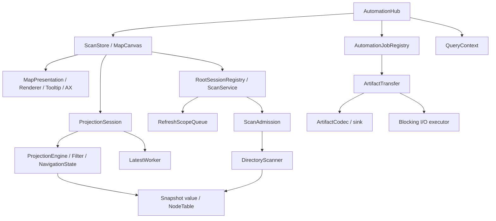

# 최적화 구현을 위한 단일 책임 모듈 설계

설계 기준일 2026-11-08. 구현 갱신 2026-11-09. 이 문서는 **현재 구현 감사와 목표 설계**다. 아래 새 경계·이름은 구현 완료를 뜻하지 않는다. [실행 TODO](../TODO.md)의 A00을 설계 기준으로 사용하고 각 E/B 작업에서 필요한 경계를 추출한다. 전체를 한 번에 재작성하지 않는다.

## 판정 기준

단일 책임은 파일 크기가 아니라 **그 코드를 바꾸는 이유**로 판정한다. OS 열거 API 변경, 필터 의미 변경, 동시 실행 정책 변경, 파일 형식 변경, AppKit 표시 변경이 서로 다른 모듈에 머물러야 한다. 함수만 다른 파일로 옮기고 같은 가변 상태를 공유하면 분리가 완료된 것이 아니다.

이 설계의 품질은 등급 명칭으로 증명하지 않는다. 책임·상태 소유자·입출력·의존 방향·실패/종료·독립 검증을 설명하고 실제 코드가 그 계약을 지키는지 확인해야 한다. 원본 동작은 기존 W 근거를 따르며, 모듈 경계와 Swift 실행 모델은 Mac 구현 설계다. 원본에 아래 Swift 모듈 구성이 있었다고 주장하지 않는다.

최신 구현은 [검증 기록](PROJECTION_SESSION_VALIDATION.md)을 따른다. LatestWorker의 계산을 FilterProjection으로 추출하고 ProjectionSession이 key/cache/worker를 소유하도록 구현했다. 후속 [artifact 검증](ARTIFACT_STREAMING_VALIDATION.md)에서 M09 codec/sink·M10 transaction/executor·M11 Foundation file action 경계를 구현했다. M16 job registry 추출 등은 남아 있다. 후속 [scan·scratch 검증](SCAN_RESOURCE_VALIDATION.md)에서 M04 ScanAdmission/M05 실행 경계와 M07 worker 전용 context 재사용을 구현했다. 아래 결합 감사는 **추출 전 2026-11-08 기준**이며 다른 목표 책임은 아직 설계 또는 부분 적용이다.

## 추출 전 구조에서 확인한 결합

| 현재 위치 | 확인한 책임 결합 | 먼저 확보할 경계 |
|---|---|---|
| [LatestWorker](../Sources/SpaceSnifferCore/LatestWorker.swift) | 일반 latest-only 실행기와 membership/weights/navigation/children을 계산하는 FilterProjection이 같은 파일에 있음 | 범용 실행기는 계산 의미를 모르고, projection 계산은 실행기 없이 호출 가능 |
| [ScanService](../Sources/SpaceSnifferCore/ScanService.swift) | root/subscriber 수명, 감시, pending scope, task 시작, progress/완료 반영 | 공유 root 수명과 프로세스 admission 정책 분리. generation 검사는 root 상태 소유자에게 유지 |
| [ScanStore](../Sources/MacSpaceSniffer/ScanStore.swift) | ObservableObject UI 상태, 필터 parsing 요청, worker 요청, stale 결과 검사, 탐색, 패널/파일 작업 | UI adapter와 projection session의 cache/무효화 계약 분리 |
| [ArtifactWorker](../Sources/SpaceSnifferCore/ArtifactWorker.swift) | volume 조회·trash·decode/encode·TXT 판정·파일 쓰기 | 파일 형식, artifact 작업 수명, OS 파일 동작 분리 |
| [Model](../Sources/SpaceSnifferCore/Model.swift) | 데이터 모델과 TXT Report formatter | 모델 변경과 출력 형식 변경을 분리 |
| [MapCanvas](../Sources/MacSpaceSniffer/TreemapView.swift) | geometry worker, transition/timer, palette/text, draw, hit/input, tooltip, AX 생성 | presentation 수명·그리기·tooltip·AX 소유권 분리 |
| [AutomationHub](../Sources/MacSpaceSniffer/AutomationHub.swift) | 창 선택/명령 라우팅과 artifact job admission/보관/완료 상태 | API adapter와 job registry 분리 |

이는 행 수만으로 전체 클래스가 잘못됐다는 판단이 아니다. 특히 ScanService는 root 상태 전이를 조정하는 책임을 유지할 수 있다. 추출 대상은 독립적으로 바뀌는 정책과 계산이며, 조정 코드를 없애려고 불필요한 우회 계층을 만들지 않는다.

## 모듈별 책임과 소유권

M ID는 **논리적 책임 경계**다. 모두 새 Swift Package target, protocol, actor가 되는 것은 아니다. 현재 Core → Automation → App 방향을 유지하고 먼저 같은 target 안의 internal 타입/함수로 추출한다. 표의 이름은 구현 시 확정한다.

| ID / 후보 이름 | 한 가지 변경 이유 | 소유하는 상태·입출력 | 맡기지 않을 일 | 작업 |
|---|---|---|---|---|
| M01 SnapshotStorage | snapshot 저장·복사·재사용 방식 | NodeTable page/COW; 채택 시 저장소 lease·재사용 budget. reader에 값 snapshot 제공 | 필터 조건, navigation, worker admission, UI | E01 |
| M02 TreeMutation | 트리 변경 후 일관성·태그 이전 규칙 | 이전/부분 snapshot → 새 snapshot과 명시적 변경 설명; SnapshotTree/TagPolicy 기존 기능 유지 | I/O 실행·구독 관리·projection cache | B03, R06 |
| M03 RootSessionRegistry | 공유 root와 subscriber의 생명주기 | root entries, 구독·watch 수명, root generation/revision, progress/완료 승인; 현재 ScanService가 facade 역할 | 전역 동시성 K 선택·스레드 생성·필터 평가 | E02, B08 |
| M04 ScanAdmission | blocking 작업의 실행 허가·취소·종료 정책 | process 실행/대기 수, job token, executor handle; submit → progress/result 전달 | root snapshot 직접 변경, 필터/geometry CPU 실행, MCP job 의미 | E02 |
| M05 DirectoryScanner | 파일시스템 열거·metadata 획득 규칙 | URL/scope/control → 부분/최종 ScanSnapshot; 현재 DiskScanner | UI, 구독, 전역 admission, 공개 revision | E02, R14 |
| M06 ProjectionEngine | filter와 크기에서 판정·합계를 만드는 규칙 | immutable 입력+시각+control → membership/weights/계산 결과; 기존 Filter/NavigationState/Treemap 알고리즘을 조합 | cache 수명, MainActor publish, worker 생성, AppKit | B01, B03 |
| M07 ProjectionSession | 입력 변화에 따른 재계산·재사용 정책 | 창별 key/cache/invalidation, latest request token, worker와 scratch 수명; 명령 → 완결된 결과 | UI @Published 직접 수정, 파일 I/O, geometry/font cache | B01, B02, E01 |
| M08 RefreshScopeQueue | 중복·조상 packing과 FIFO 순서 | scope index·FIFO·compaction; insert/pop/removeCovered | OS 감시·scan 시작·debounce timer·thread pool | B08 |
| M09 ArtifactCodec | SNS/TXT 바이트 표현 규칙 | snapshot/선택/weights → record/line emitter, Data sink; 입력 bytes → snapshot | 경로 권한·덮어쓰기 정책·job 상태·worker admission | B07, R02/R10 |
| M10 ArtifactTransfer | artifact 입출력의 한 번의 성공/실패·정리 | 캡처된 request, file sink/임시 파일 소유권, commit/abort; codec과 I/O executor 호출 | 새 필터 문법, UI 패널, MCP job 보관, volume/trash | B07, E02 |
| M11 DesktopFileActions | macOS 파일 작업 API·권한 동작 | volumes/trash/reveal 등 OS adapter; 호출 결과/오류 | SNS/TXT 형식, projection cache, 스캔 admission 정책 | A00, B07 |
| M12 MapPresentation | geometry 결과와 시간에 따른 현재 표시 상태 | 요청 key/generation, 현재·직전 MapItem, transition/timer, bounded text/palette 도움 타입 | 전체 tree 판정, 파일 I/O, AX 객체와 tooltip 등록 | B04, B05, B06 |
| M13 MapRenderer | presentation을 그리는 방식 | immutable 표시 항목/스타일/dirty rect → draw; frame 밖 snapshot 보유 없음 | worker submit, timer 시작, tooltip/AX 재등록, navigation 상태 변경 | B05, B06 |
| M14 TooltipRegistry | 표시 항목의 tooltip 등록·해제 | canvas 등록 token/현재 presentation revision; update/reset | draw 실행, AX, engine snapshot cache | B05 |
| M15 AccessibilityPresenter | AX label/frame/action을 현재 항목에 연결 | 최대 500개 element 수명, 현재 identity/frame, activation 재검증 | geometry 계산, tooltip 등록, 과거 snapshot 강한 보관 | B05 |
| M16 AutomationJobRegistry | artifact job의 접수·진행·보관 정책 | active 최대2/최근32 계약, job id/phase, 완료 한 번; 결과 DTO | 파일 직접 쓰기, 창 선택, filter 계산, scan admission K | B07, G90 |

M06은 기존 Filter·NavigationState·Treemap을 하나의 거대한 클래스로 합친다는 의미가 아니다. 기존 순수 계산들의 책임은 유지하고 projection 조합을 LatestWorker에서 분리한다. M12의 text/palette cache도 key/eviction을 가진 작은 도움 타입으로 둘 수 있으나, 별도 서비스·전역 singleton으로 만들 이유는 없다.

### 남기는 adapter의 책임

| 현재 adapter | 유지할 책임 | 위임할 책임 |
|---|---|---|
| ScanStore | UI intent 전달, 관찰 가능한 상태의 원자적 반영, 패널/알림 연계 | projection 계산·cache/무효화 정책은 M06/M07, 파일 전송은 M10 |
| MapCanvas | AppKit lifecycle, input을 UI intent로 변환, hit identity 검증, renderer/presenter 연결 | geometry/animation 수명 M12, draw M13, tooltip M14, AX M15 |
| AutomationHub | 창 선택, command/arguments 검사, DTO 직렬화, 응답/오류 변환 | query는 기존 QueryContext, job 상태 M16, 작업은 기존 서비스 또는 M10 |
| LatestWorker | latest-only 요청 교체·협력 취소·shutdown | 필터·정렬·cache key·파일 형식·ScanAdmission 정책을 알지 않음 |

UI intent와 MCP intent는 같은 상태 변경 진입점을 사용한다. 별도 MCP 전용 엔진을 만들어 결과나 무효화 규칙이 갈라지지 않게 한다.

## 의존 방향

현재 package 경계는 [Package.swift](../Package.swift)의 `SpaceSnifferCore`, `SpaceSnifferAutomation(Core 의존)`, `MacSpaceSniffer(Core/Automation 의존)`를 유지한다. Core에서 AppKit·SwiftUI·Automation target을 import하지 않는다. 파일 내부 분리는 모듈 의존성을 바꿨다는 증거가 아니므로 실제 imports와 호출 경로를 확인한다.

도식의 화살표는 호출/구성 방향이다. worker의 result callback은 값과 token을 소유자에게 돌려주며 역방향 import나 worker의 UI 참조를 만들지 않는다. Blocking I/O executor는 실행 수단이고 ScanAdmission은 scan 허가 정책이다. 둘을 구별하고 scan/artifact가 같은 executor를 공유할지는 E02 경합 측정으로 정한다. artifact 최대2와 scan K를 하나의 상수로 합치지 않는다.

## 경계별 입력·출력 계약

아래는 필요한 의미 계약이며 구현할 Swift 선언을 확정한 API 문서가 아니다. 증명되지 않은 필드·dirty 의미를 먼저 production API로 만들지 않는다.

| 경계 | 입력 | 출력/실패 | 승인 책임 |
|---|---|---|---|
| root → admission → scanner | root identity, scope, generation, control, 원래 snapshot | progress / 최종 결과 / 취소 / 오류; 완료 전달 한 번 | M03가 아직 유효한 root/generation인지 검사한 뒤 반영 |
| UI → projection session | snapshot identity, filter 입력, mode/hidden, 탐색 요청, 이전 상태, 시각 정책 | 완결된 membership/weights/navigation 결과 또는 취소; parse 오류 fallback 유지 | M07 요청 token과 ScanStore 현재 session을 확인한 뒤 한 번 publish |
| mutation → incremental engine | baseline/result identity, dirty IDs·속성·topology 의미 | 새 결과 또는 `requiresFullProjection` | baseline 불일치·정보 부족이면 전체 계산 |
| presentation → draw/tooltip/AX | 같은 presentation revision의 표시 항목·현재 rect/스타일 | draw 또는 등록 변경; AX action은 현재 identity 재검증 | MainActor presentation 소유자가 순서·shutdown 보장 |
| job → artifact transfer | 접수 시 고정된 snapshot/filter/scope/revision, output 정책 | commit된 output 정보 또는 오류; 부분 파일 정리 | M10이 출력 성공을 판정하고 M16이 job 상태로 변환 |

공개 projection UUID, 내부 입력 cache key, scan generation, storage lease는 목적이 다르다. 하나의 `revision`으로 합치지 않는다. 입력 DTO가 모든 모듈을 잡은 거대한 context/service locator가 되지 않도록 필요한 값만 전달한다.

## cache·pool·worker의 수명

| 자원 | 단일 소유자 | 무효화·종료 계약 |
|---|---|---|
| root entry/watch/현재 scan 승인 | M03 | 마지막 구독 해제 시 watch·대기 허가 취소, 진행 scan 협력 취소; 늦은 완료 무시 |
| scan admission slot | M04 | queued 취소는 scanner 호출 0회. running 취소가 접수돼도 실제 작업 종료 전 slot 반환 금지. 최종 완료 시 정확히 한 번 반환 |
| page 재사용 저장소 | M01, 채택 시 | frozen reader 생존 중 반납 금지. storage 전용 budget; root 해제/pressure/oversize 정책. allocator가 root·UI를 참조하지 않음 |
| projection scratch/cache | M07 소유 worker 또는 전용 계산 workspace | 동시 작업이 같은 mutable buffer를 공유하지 않음. immutable 결과로 내보낸 배열을 scratch처럼 덮어쓰지 않음. key 변경/취소/shutdown 계약 |
| geometry/transition/text/palette | M12 | 현재·직전 표시 범위로 제한. geometry key 변경·전환 종료·창 분리 시 필요한 자원만 유지/정리 |
| tooltip registration | M14 | 이전 registration 해제, presentation 교체·창 분리 시 reset; 위치 갱신은 draw의 부수효과가 아님 |
| AX element | M15 | bounded 현재 항목만 보유. callback에 과거 snapshot 캡처 금지. activation 시 최신 identity/path 확인 |
| file sink/임시 output | M10 | commit/abort 단 한 번. 작업 소유 파일만 정리. output exclusive 정책에 TOCTOU 도입 금지 |
| automation job record | M16 | terminal 상태 이후에만 eviction. 완료 task capture와 큰 snapshot을 결과 목록에 보관하지 않음 |

M01의 page allocator와 M07의 scratch 재사용을 범용 `PoolManager` 하나로 합치지 않는다. 보유 이유·반납 조건·안전성 증명이 다르다. 모든 cache를 전역 `CacheManager`로 합치거나 pool마다 actor를 추가하는 설계도 채택하지 않는다.

## 단계별 추출과 검증

1. **G00:** 현재 결과·비용을 고정한다. A00에서 책임/소유자/계약을 리뷰하고 기존 경로를 reference로 남긴다.
2. **A00/E01/E02:** 필요한 최소 경계부터 추출한다. LatestWorker와 FilterProjection의 파일/타입 책임, scan 실행 허가, storage 재사용 수명을 각각 독립 변경으로 분리한다. 새 pool/executor와 계산 알고리즘 변경을 한 패치에 섞지 않는다.
3. **B01/B02:** ProjectionSession이 cache/invalidation을 소유하게 한다. ScanStore에는 최종 UI 상태 반영과 intent adapter를 남긴다. 동일 입력 판정과 UI/MCP 공개 revision을 각각 검증한다.
4. **B05/B04/B06:** M12~M15를 실제 수명 경계에 맞춰 필요한 순서로 추출한다. 현 UI·곡선·hit/tooltip/AX가 같음을 확인한 뒤 재사용/visibility 개선을 켠다.
5. **B07:** codec emitter → output transaction → job registry 순서로 경계를 고정한다. 순수 바이트 대조 후 오류/경합·완료 상태를 검사한다. DesktopFileActions를 artifact 형식 처리에서 분리한다.
6. **B08/B03:** queue oracle과 dirty provenance를 각각 확보한 뒤 자료구조/증분 알고리즘을 적용한다. 이미 고정한 root/projection 소유권을 우회하지 않는다.
7. **G90/G99:** 실제 통합·수명·성능과 패키징까지 확인한다. 설계 문서 체크만 통과한 것을 모듈화 구현 완료로 보고하지 않는다.

분리만 하는 변경은 결과 동등성과 기존 관련 회귀를 확인한다. 개선을 주장하려면 같은 fixture의 release 비용을 별도로 비교한다. 범용 protocol/타입 소거·per-node closure·await·추가 배열 복사로 hot loop 비용을 늘리지 않는다. I/O·clock·sink처럼 실제 교체가 필요한 경계에만 작은 주입 지점을 둔다.

## 독립 검증과 완료 기준

| 책임 | 독립적으로 확인할 핵심 |
|---|---|
| M01 | 실제 reuse된 저장소 + 여러 세대 frozen reader, bounded bytes/eviction. 값 타입 선언만 확인하는 검사는 불충분 |
| M03/M04 | 작은 controllable scanner로 queued/running 취소, slot 조기 반환 금지, 늦은 generation, 마지막 구독 해제, 완료 한 번 |
| M06/M07 | AppKit/MCP 없이 full oracle와 cache-hit/fallback 비교. navigation만 바꿀 때 membership 실행 수 불변 |
| M08 | 기존 배열 큐와 각 연산별 differential 검사, FIFO·prefix lexical 의미 보존 |
| M09/M10 | codec golden bytes와 file sink 실패·partial write·동일 output 경합을 분리해서 확인 |
| M12~M15 | 계산 결과 oracle + 실제 AppKit lifecycle/hover/resize/전환/VoiceOver/캡처 확인 |
| M16/adapters | 실제 STDIO의 job/상태/revision 계약 확인; registry 가짜 성공만으로 파일 성공을 주장하지 않음 |

완료 시 각 모듈에 ① 한 문장의 책임 ② 상태 소유자 ③ 입력/출력 ④ 허용 의존성 ⑤ 취소/오류/종료 ⑥ 검증 근거를 남긴다. 같은 cache·token·queue에 두 writable owner가 있거나 ScanStore/MapCanvas에 기존 계산 정책을 복사해 남기면 미완료다. 파일 분리 수·protocol 수·클래스 수는 성공 지표가 아니다.

B08 구현 경계: `RefreshQueue`가 packing·FIFO·작은 배열/큰 인덱스 전환·COW·compaction을 소유하고, `RefreshPathIndex`는 lexical prefix 검색과 압축 edge/slot만 소유한다. 감시 세대·debounce·scan 실행은 기존 ScanService에 남는다. [측정 및 남은 QA](REFRESH_QUEUE_VALIDATION.md).

B08.08: ScanService는 internal MonitorFactory로 감시 생성 경계만 주입받고, generation 검사는 기존 actor changed에서 처리한다. RefreshQueue 관측은 weak Storage witness와 count/slot만 반환하며 watcher나 scan을 소유하지 않는다. [실제 취소·수명 검증](REFRESH_LIFECYCLE_VALIDATION.md).

B05 AX 부분: M15는 MapAccessibilityCache 파일로 추출했다. 경로 identity/현재 ID mapping/500개 후보/element label·frame/정리만 소유하며 snapshot/MapItem은 보관하지 않는다. MapCanvas는 좌표 변환과 activation 직전 현재 node 검증을 소유한다. text cache·tooltip의 후속 분리는 아래 최종 구현 경계를 따른다. [검증](ACCESSIBILITY_CACHE_VALIDATION.md).

B05 tooltip 부분: M14는 MapTooltipRegistry로 분리했다. 현재 등록 영역/id/path/tag/token과 weak view만 소유하며 내용·snapshot은 보관하지 않는다. MapCanvas는 현재 presentation과 node 조회, 기존 tooltip 문자열 구성을 소유한다. [등록/전환/수명 검증](TOOLTIP_REGISTRY_VALIDATION.md).

## 2026-11-09 최종 구현 책임

M01~M16은 논리적 책임이며 전부 같은 이름의 파일로 분리됐다는 뜻은 아니다. 실제 hot path는 다음 소유자로 나뉜다.

| 소유자 | 단일 책임과 경계 | 종료·검증 |
|---|---|---|
| ProjectionSession | 입력 판정/parse·evaluation·작은 navigation cache 수명 조정 | shutdown 시 source/cache 해제, opaque identity와 full oracle 대조 |
| ProjectionDelta | 증명 가능한 sparse leaf 변경과 조상 기여 delta 계산 | 출처/필드/범위 불충분 시 full fallback; UI 참조 없음 |
| GeometrySession | child order와 rect key/예산 관리 | 숫자/ID만 보유; 계산은 lock 밖, generation이 reset 뒤 commit 거절 |
| MapTextCache | 현재 title/size/font 폭 계산·bounded 재사용 | 정확 UTF8/bytes/font 무효화, hidden/detach 시 clear |
| MapWindowLifecycle | native visibility/mini/close 관측 lease | weak callback·generation·NotificationLease 해제 |
| ExplicitWindowRetention | 명시적 hidden window/model 수명과 자동 종료 억제의 균형 | 0→1 시작, 마지막 해제·deinit 종료; 실제 close와 hide 구분 |
| LatestWorker | running 1/pending 1, publication handoff, pending capture 해제 | token·lock·exact terminal 정책; UI 승인 정책은 호출자 소유 |
| ScratchBudget | private idle scratch의 charge/pressure/epoch | 결과 배열·snapshot·active RAM은 관리하지 않음 |
| PathIO/ArtifactIOExecutor | blocking metadata/artifact native serial lane | queue 상한·취소·continuation 전달; 계산 의미나 UI 상태 승인 없음 |
| WorkerTelemetry | bounded stage duration/queue/terminal/thread 표본 | immutable 진단 snapshot과 writer 격리; 호출 경로/개인 경로 미보관 |

ScanStore는 사용자 intent와 최종 UI publish 승인, MapCanvas는 AppKit draw/좌표·입력 adapter를 유지한다. M16의 최근 job registry는 AutomationHub 내부에 남아 있다. 이 부분까지 별도 모듈로 추출했다고 주장하지 않는다. production node/page object pool은 채택하지 않았고 test/probe prototype만 존재한다. [동등성·실측·제약](FINAL_OPTIMIZATION_VALIDATION.md), [무효화 계약](OPTIMIZATION_INVALIDATION.md).
