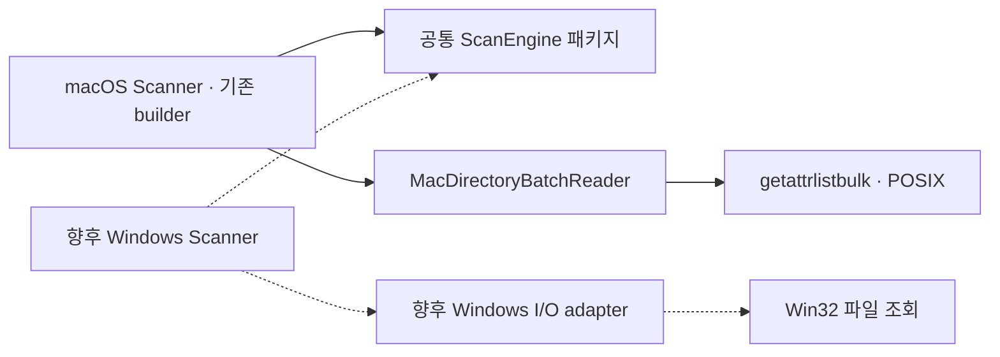

# 공통 스캔 엔진과 플랫폼 어댑터 — 2026-11-21

추가 2026-11-23: [Windows 앱 구현·패턴 경계·실행 검증](WINDOWS_APP_RESULTS.md). Win32 batch/fallback reader와 별도 native Windows UI까지 구현했다.

후속 2026-11-23: [132 Windows 실기기 검증](WINDOWS_132_PHASE1_RESULTS.md)에서 공통 엔진 debug/release 각22개와 실제 Windows 파일 I/O가 통과했다. 아래는11월21일 설계 기록이며, production Win32 reader·전체 Windows 앱 미완료는 유지한다.

후속: [C3 품질 재검토·실제 결함 재현과 수정](SCAN_ENGINE_QUALITY.md). 아래 C2 계측/통합 결과는 완료 당시 기록이며 현재 C3와 구분한다.

worker·지속 공급 window·취소·예산·합산 batch·발행 정책의 실제 구현을 독립 [SpaceSnifferScanEngine](../Packages/SpaceSnifferScanEngine/Package.swift) 패키지로 분리했다. macOS가 이 공통 구현을 사용한다. Windows용 reader를 같은 폴더 batch 계약으로 연결하면 이 부분의 개선과 테스트를 공유할 수 있다. **Windows 네이티브 reader와 Windows 실행 검증은 아직 없다. 전체 Mac Core가 이미 Windows에서 빌드된다는 뜻은 아니다.**

## 책임과 의존 방향

| 책임 | 공통 구현 | macOS에 남긴 것 | Windows 후속 |
|---|---|---|---|
| worker·취소·permit·ticket | DirectoryWorkerPool, ScanControl, DirectoryIOBudget, DirectoryReadTicket | thread QoS, reader3/queue24/I/O8 설정 | OS thread 설정 및 실측 자원 한도 |
| 지속 공급 | DirectoryReadWindow의 슬롯·중복 방지·재보충 loop | builder의 후보 폴더 제공·부모/볼륨 검사 | Windows 후보·volume 정책 연결 |
| admission | DirectoryReadWindowPolicy | sibling64, entry64…1024 등 Mac 실측값 | 별도 임계값, entry hint가 없을 때 bounded admission 허용 여부 |
| batch·metadata 전달 | DirectoryBatchReader, typed Entry/Listing/Output | native metadata, raw UTF-8 검증, POSIX fallback | UTF-16/대소문자/전체 file ID·native 오류를 보존하는 reader |
| 합산·발행 | ObservedByteBatch, ScanPublication | 현재 NodeTable에 delta 적용하는 builder | Windows builder가 같은 정책 사용 |
| tree·개요·도메인 기능 전체 | 이번 독립 패키지로 모두 옮기지는 않음 | DiskNode/NodeTable, ScanOverview·filter/SNS 등이 기존 Core에 남음 | dependency graph 분리 후 단계적으로 공유 |
| 볼륨·watch·UI | 공유 대상으로 섞지 않음 | System/Data 별칭, mount 정책, FSEvents, AppKit/SwiftUI | Windows volume/reparse/watch/UI 어댑터 |

그림은 이번에 분리한 폴더 batch 경계다. root stat, volume/watch와 전체 builder/domain model의 플랫폼 분리는 남아 있으며 Mac Core를 통째로 교체 가능한 상태라고 주장하지 않는다.

패턴은 폴더 단위 **Adapter + Strategy + 구성 주입**이다. 파일마다 protocol existential이나 새 객체를 만들지 않는다. worker는 generic batch 결과만 운반하고 tree/ID/합계를 변경하지 않는다. 현재 Core API의 `ScanControl` 등은 [bridge](../Sources/SpaceSnifferCore/ScanEngineBridge.swift) alias로 유지하며 알고리즘을 복제하지 않는다.

[MacDirectoryBatchReader](../Sources/SpaceSnifferCore/MacDirectoryBatchReader.swift)는 실제 기존 조회에 연결됐다. [MacScanResources](../Sources/SpaceSnifferCore/MacScanResources.swift)는 Mac에서 측정한 수치를, Mac worker 구성은 thread QoS를 공통 알고리즘 밖에 둔다. 플랫폼마다 budget 인스턴스를 명시적으로 구성한다. 공통 타입에 Darwin/WinSDK 필드나 macOS 전용 기본값을 넣지 않았다.

완료된 ticket도 소비 전까지 window 용량을 점유한다. 현재 ticket을 꺼내 빈자리를 보충하고, I/O permit을 잡지 않은 상태에서 기다리는 순서를 유지한다. builder가 느릴 때 완료 결과가 무한히 쌓이지 않는다. 취소는 해당 control의 queued job만 폐기하고 자신이 제출한 결과를 drain한 뒤 끝난다.

## Windows 어댑터 계약

`DirectoryListing<WindowsMetadata>`처럼 metadata 타입을 그대로 전달한다. 공통 worker가128-bit file ID를64-bit inode로 축소하거나 volume ID를POSIX dev_t로 바꾸지 않는다. fixture 테스트는 volume UInt64.max와128-bit ID 상·하위값, 이름의 UTF-8 표현 보존을 확인한다. 실제 Windows 파일 이름·handle·UTF-16 파싱 검증을 대체하지 않는다.

Windows batch 조회의 조사 후보는 `GetFileInformationByHandleEx`의 directory 정보 class다. `FILE_ID_EXTD_DIR_INFO`는 이름, 날짜, logical/allocated size, 속성, reparse tag와128-bit FileId 필드를 제공한다. 이는 문서 기반 후속 설계 후보이며 실제 지원 여부·fallback을 Windows filesystem별로 확인해야 한다. [Microsoft API 문서](https://learn.microsoft.com/en-us/windows/win32/api/winbase/nf-winbase-getfileinformationbyhandleex), [반환 구조 문서](https://learn.microsoft.com/en-us/windows/win32/api/winbase/ns-winbase-file_id_extd_dir_info).

어댑터가 맡을 검증은 다음과 같다.

- `NextEntryOffset`·길이·버퍼 경계·잘린 record와 native handle의 정리.
- UTF-16 이름, 대소문자, UNC/확장 경로, junction/reparse 및 volume 범위. Mac의 raw UTF-8 규칙을 그대로 적용하지 않는다.
- allocated/logical 의미, hardlink identity, 전체128-bit ID, 생성/접근/수정 시각과 속성 보존.
- 지원하지 않는 query class와 네트워크/파일시스템별 fallback, 오류 domain/code·재시도 분류.
- 순서/노드 ID·SNS/TXT·취소·root 교체·watch 결과의 계약. 원본 Windows 프로그램에 대한 동적 동등성 검증은 별도다.

## 성능 비용과 검증

공통 Entry의 size/stride/alignment가 이전 Mac inline metadata 구조와 같은지 Core 테스트로 확인한다. `ObservedByteBatch`와 발행 정책은 모듈 경계 너머에서 inline할 수 있게 했다. per-entry 객체·가상 dispatch를 추가하지 않고 폴더별 작업을 제출할 때만 adapter를 호출한다.

독립 패키지의 production9파일에는 Foundation 외 import가 없고 macOS 배포 조건도 없다. [경계 검사](../scripts/check-scan-platform-boundary.py)는 이 의존 방향과 중복 queue 구현 제거를 확인한다. 이는 source 검사이며 Windows SDK 실행 검증은 아니다. [독립 패키지 테스트](../Packages/SpaceSnifferScanEngine/Tests/SpaceSnifferScanEngineTests/SharedEngineTests.swift)는 다른 metadata 타입, unknown hint, 완료 결과 용량, 중복 계획, queue 포화, 취소와 합산/발행 정책을 다룬다.

새 dependency가 필요한 현재 Core probe는 [빌드 도구](../scripts/bench/scan-platform/build_probe.py)로 Core/profile과 공유 package를 동결해 SPM release로 만든다. 과거 frozen 단일 module swiftc 결과와 합치지 않는다. 앱 빌드 방식과 source/binary hash를 구분한다.

## p95 원인 재검토

플랫폼 분리 전 rolling C1의 **동일 바이너리·동일 parallel2 모드**를 before/parallel2 두 label로 놓고3입력×99쌍×3변형=891회 측정했다. serial은 다른 모드의 보조 대조군이며 워밍업27회는 따로 보존했다.

| 입력 | A p50 / p95 ms | 동일 binary B p50 / p95 ms | 기존 회귀 기준 |
|---|---:|---:|---|
| small1000 | 4.920 / 9.689 | 5.284 / 10.184 | paired CI 하한−12.64%로 미달 |
| wide4100 | 9.211 / 15.304 | 9.163 / 16.565 | 통과 |
| normal10000 | 15.789 / 25.808 | 16.048 / 28.907 | p95 기준 미달 |

소스 변경이 없어도 기존 gate가 탈락하는 수집 조건이다. 따라서 앞선 C1의 p95 미달을 scheduler 회귀로 확정할 근거가 부족하다. 이것이 실제 회귀가 없다는 증명이나 배포 승인도 아니다. gate를 완화하거나 같은 실험을 통과할 때까지 반복하지 않는다.

rusage와 SDK process I/O를 scan 직후, digest 전에 수집했다. worker가0회인 small/flat의 느린 상위20표본에서는 중간 구간보다 involuntary context switch 중앙값이 높았다(small36→104, flat48→106.5). 물리 read bytes 중앙값은 양쪽0이었다. OS scheduling·cached metadata 대기 등의 조사 지표이며 정확한 off-CPU stack이나 원인별 기여도 측정은 아니다. 전체 CPU 시간도 증가해 wall−CPU만으로 원인을 단정하지 않는다.

[계획·원시값·검증 기록](validation/scan-platform-2026-11-21/README.md), [후속 TODO](SCAN_PLATFORM_TODO.md). 기존 설치0.2.1과 현재 실행 중인 앱은 유지한다. Windows native 검증·신뢰 가능한 전체 성능 gate·후보 GUI/Universal 배포는 완료로 표시하지 않는다.

## 최종 통합 확인

- 독립 shared package11개, Mac 프로젝트302개(환경 skip4), TSAN23개 실패0.
- Apple Silicon debug/Intel release CLI에서 실제100폴더×96파일을 검사했다. 파일9,600·폴더101·logical/allocated oracle 일치, TXT byte 일치 및 ARM SNS를 양쪽에서 로드하는 검증 통과. Windows native 실행 검증은 아니다.
- 개발 볼륨에 SNS를 저장하던 첫 통합 시도는 실제 ENOSPC로 실패했다. 그 기록을 보존하고 출력만 내부 저장소로 바꾼 별도 시도로 통과했다. writer나 판정 기준은 변경하지 않았다. 작업자가 생성한 이전 원시 evidence2개는 내부 원본 백업과 byte 동일성을 확인한 gzip으로 보존해 약40MB를 확보했다.
- 공통화 전 rolling C1과 이후 C2를 동일 SPM release 방식으로 빌드해3입력×15쌍×3변형=135회, 별도 warmup27회 통합 비교했다. 모든 oracle/digest가 일치했다. 이는 smoke/exploratory 결과이며 표본 수·입력 수·A/A의 수집 변동 때문에 채택 근거가 아니다.

| 입력 | C1 p50 ms | shared C2 기본2 p50 ms |
|---|---:|---:|
| small1000 | 3.715 | 3.711 |
| normal10000 | 10.800 | 11.046 |
| wide4100 | 7.251 | 7.600 |

이 표를 무회귀 입증이나 정확한 공통화 비용으로 해석하지 않는다. 원시 p95/CPU/RSS도 보존한다. 기존 기본 설치0.2.1은 변경하지 않았고, 후보의 최종 GUI·패키징·배포는 아직 진행하지 않았다.

Core의 `ScanControl` 등 명칭은 alias로 소스 호환을 유지한다. 이미 컴파일된 Swift 소비자의 binary ABI 호환을 보장하는 변경은 아니며 앱/소비자는 재빌드해야 한다.
